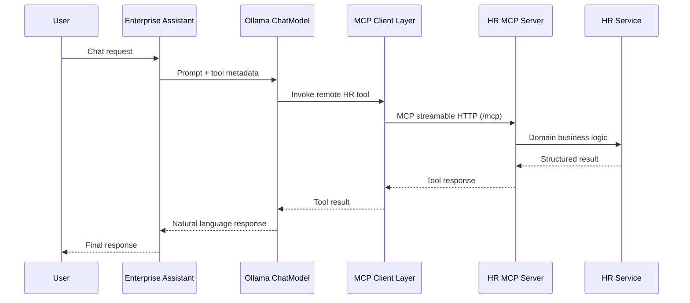

# Chapter 10 Enterprise Assistant MCP Client

## Purpose

`chapter-10-mcp-enterprise-assistant-client` is the Acme Enterprise Assistant acting as an MCP client.
It accepts user chat requests, uses Spring AI + Ollama for reasoning, discovers remote HR tools, and invokes those tools through the HR MCP server.

## Chapter 10 Mapping

This project demonstrates Chapter 10 orchestration behavior:

- Assistant remains focused on conversation and orchestration.
- HR business logic remains in the remote HR MCP server.
- LLM can invoke remote MCP-exposed tools through Spring AI tool-calling.

## Endpoint

- `POST /api/assistant/chat`

Example request:

```json
{
  "message": "I want to take leave next Friday. Do I have enough annual leave remaining, and can you submit the request?",
  "employeeId": "E1001"
}
```

## Setup

Prerequisites:

- Java 25
- Maven 3.9+
- Running `chapter-10-mcp-hr-server`
- Ollama running with a pulled chat model (for runtime chat)

Environment variables (optional):

- `HR_MCP_SERVER_URL` (default `http://localhost:8091`)
- `OLLAMA_BASE_URL` (default `http://localhost:11434`)
- `OLLAMA_CHAT_MODEL` (default `llama3.2`)
- `OLLAMA_TEMPERATURE` (default `0.1`)
- `ASSISTANT_PORT` (default `8090`)

## Run

1. Run tests:

```bash
mvn test
```

2. Start app:

```bash
mvn spring-boot:run
```

3. Call endpoint:

```bash
curl -X POST http://localhost:8090/api/assistant/chat \
  -H "Content-Type: application/json" \
  -d '{"message":"I want to take leave next Friday. Do I have enough annual leave remaining, and can you submit the request?","employeeId":"E1001"}'
```

## Architecture



## MCP Client vs MCP Server

- MCP Client: discovers remote capabilities and invokes them.
- MCP Server: exposes reusable domain tools and enforces business rules.

## Why MCP Is Different from Local Tool Calling

Local Tool Calling keeps tools inside one assistant service.
MCP moves tools to independent services so multiple assistants can reuse the same HR capabilities with less duplication and cleaner ownership.
