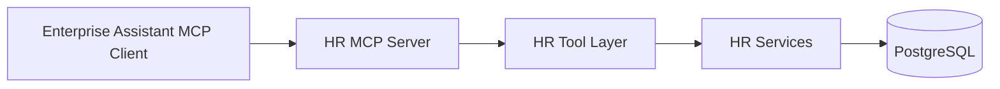

# Chapter 10 MCP HR Server

## Purpose

`chapter-10-mcp-hr-server` is a domain-focused HR MCP server for Acme Corporation.
It owns HR capabilities and exposes them as reusable remote tools instead of embedding HR logic inside the assistant application.

## Chapter 10 Mapping

This project demonstrates the Chapter 10 architectural shift:

- Chapter 9: local Tool Calling inside one assistant.
- Chapter 10: distributed Tool Calling through an independent MCP server.

The server owns business rules for:

- `findEmployee`
- `getLeaveBalance`
- `submitLeaveRequest`
- `searchHrPolicies`

## MCP Server Responsibilities

- Own HR domain capabilities.
- Keep business logic in service classes.
- Expose small, focused tool methods.
- Return structured records.
- Validate input with Jakarta Validation.
- Publish health endpoint via Spring Boot Actuator.

## Setup

Prerequisites:

- Java 25
- Maven 3.9+
- PostgreSQL (or Docker Compose)

Environment variables (optional):

- `HR_DB_URL` (default `jdbc:postgresql://localhost:5434/hr_mcp`)
- `HR_DB_USER` (default `postgres`)
- `HR_DB_PASSWORD` (default `postgres`)
- `HR_SERVER_PORT` (default `8091`)

## Run

1. Run tests:

```bash
mvn test
```

2. Start server:

```bash
mvn spring-boot:run
```

3. Health check:

```bash
curl http://localhost:8091/actuator/health
```

## MCP Endpoint

The server exposes the Spring AI MCP streamable HTTP endpoint at:

```text
http://localhost:8091/mcp
```

Use an MCP-capable client (like the chapter 10 assistant client) to discover tools and invoke them over the MCP protocol.

## Architecture



## MCP Client vs MCP Server

- MCP Server: owns and exposes domain capabilities.
- MCP Client: discovers and invokes capabilities.

## Why MCP Is Different from Local Tool Calling

With local Tool Calling, the assistant application directly contains HR logic.
With MCP, the assistant calls a remote capability provider.
This enables reuse, independent deployment, and domain ownership across multiple assistants.
