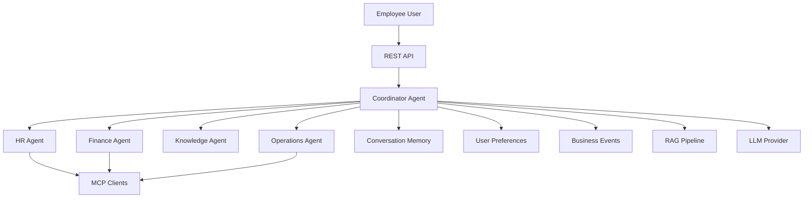
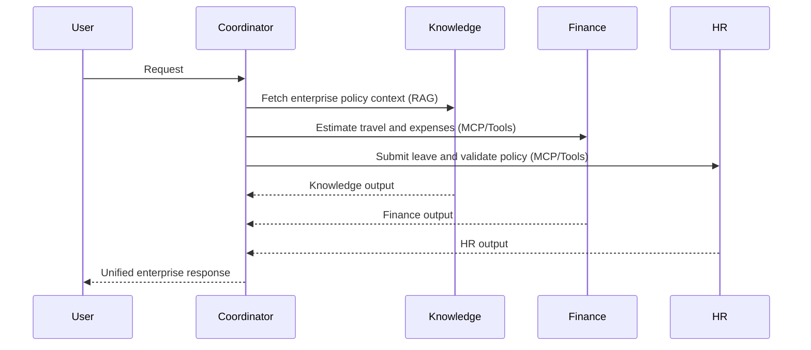
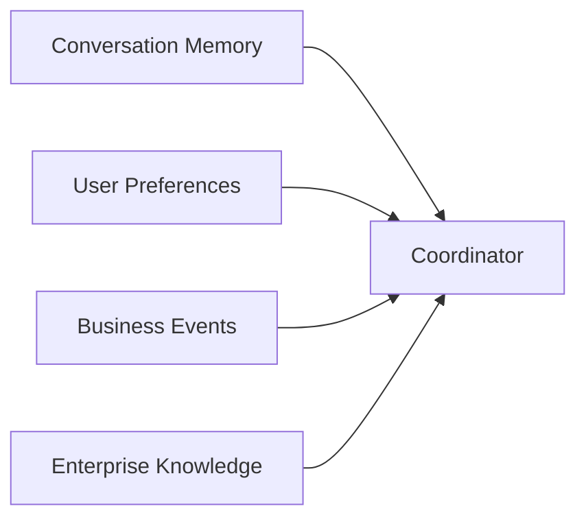

# Chapter 11: Memory and Multi-Agent Systems

## Project Overview

This module is the official Chapter 11 reference implementation for the Acme Corporation Enterprise Assistant.

It evolves the prior single-agent assistant into a memory-enabled multi-agent platform that combines:

- Conversation memory
- User profile memory
- Business event memory
- Specialist-agent orchestration
- RAG over enterprise documentation
- Tool calling via enterprise tool services
- MCP-based integration adapters

Employees interact with one REST API while a Coordinator Agent routes and merges specialist outputs.

## Features

- Multi-conversation support with explicit conversation IDs
- Concurrent multi-user memory persistence in PostgreSQL
- User preference memory independent from chat transcript memory
- Structured business events stored as `BusinessEvent`
- Specialist agents: HR, Finance, Knowledge, Operations
- Coordinator orchestration with failure-tolerant specialist execution
- RAG retrieval over enterprise documents using `VectorStore`
- MCP client adapters for HR, Finance, and Operations capabilities
- Local profile (Ollama) and cloud profile (OpenAI)
- Observability logs for selected agents, conversation IDs, tool/MCP activity, document retrieval, prompt size, and response time

## Architecture



## Multi-Agent Workflow



## Memory Architecture



## Prerequisites

- Java 25
- Maven 3.9+
- Docker + Docker Compose (recommended)

## Running with Ollama (Local Development)

1. Start infrastructure:

```bash
docker compose up -d
```

2. Pull local models:

```bash
docker exec -it chapter11-ollama ollama pull llama3.1
docker exec -it chapter11-ollama ollama pull nomic-embed-text
```

3. Run the application:

```bash
mvn spring-boot:run
```

## Running with OpenAI (Cloud Profile)

1. Set API key:

```bash
export OPENAI_API_KEY=<your-key>
```

2. Run with profile:

```bash
mvn spring-boot:run -Dspring-boot.run.profiles=openai
```

## Docker Compose

The compose stack includes:

- PostgreSQL + pgvector
- Ollama
- Optional Open WebUI

Start all services:

```bash
docker compose up -d
```

## REST API

### `POST /chat`
Start a new conversation.

Request:

```json
{
  "userId": "EMP-1001",
  "message": "Please estimate travel expenses for Amsterdam and check policy"
}
```

### `POST /chat/{conversationId}`
Continue an existing conversation.

### `GET /memory/{conversationId}`
Retrieve full conversation history.

### `GET /users/{id}/preferences`
Retrieve user preference memory.

### `POST /users/{id}/preferences`
Create or update user preference memory.

```json
{
  "preferredProgrammingLanguage": "Java",
  "preferredFramework": "Spring Boot",
  "preferredResponseStyle": "concise",
  "department": "Architecture"
}
```

### `GET /events`
Retrieve all business events (optional filter: `?userId=EMP-1001`).

### `GET /agents`
Retrieve available specialist-agent catalog.

## Sample Multi-Agent Scenario

Request:

```text
I'm travelling to Amsterdam next week for the Project Orion architecture workshop.
Can you estimate travel expenses, check the company travel policy, submit leave for Friday,
and prepare a summary for my manager?
```

Observed behavior:

- Coordinator selects Knowledge, Finance, and HR agents
- Knowledge agent retrieves policy snippets via RAG
- Finance agent invokes MCP adapter for travel estimate
- HR agent invokes MCP adapter for leave submission
- Coordinator merges outputs into one user-facing response
- Business events are recorded for each completed specialist task

## Memory Design

- Conversation Memory:
  persisted message-level history by `conversationId`
- User Profile Memory:
  persistent user preferences by `userId`
- Business Event Memory:
  auditable event timeline using `BusinessEvent`

## RAG Pipeline

1. Startup ingestion reads `src/main/resources/knowledge/*.md`
2. Documents are embedded and indexed in `VectorStore`
3. Coordinator performs similarity search before synthesis
4. Retrieved snippets are injected into specialist context

## Tool Calling

Enterprise tool methods include:

- `submitLeave()`
- `estimateTravelExpenses()`
- `createExpenseClaim()`
- `lookupEmployee()`
- `restartServer()`

These are domain services and can be reached by specialist agents directly or via MCP fallback behavior.

## MCP Integration

MCP adapters are provided in the `mcp` package:

- `HrMcpClient`
- `FinanceMcpClient`
- `OperationsMcpClient`

Each adapter attempts remote MCP HTTP execution and falls back to local enterprise tool services when unavailable.

## Testing

Run all tests:

```bash
mvn clean test
```

Coverage includes:

- Conversation memory behavior
- Coordinator routing and synthesis
- Tool service behavior
- RAG retrieval behavior
- MCP fallback integration
- REST API endpoints
- PostgreSQL Testcontainers persistence integration

## Project Structure

```text
src/main/java/com/acme/assistant/chapter11
├── agents
├── advisors
├── config
├── controllers
├── coordinator
├── dto
├── entities
├── exceptions
├── mcp
├── memory
├── rag
├── repositories
├── security
├── services
└── tools
```

## Future Improvements

- Replace HTTP MCP adapter fallback with strict MCP protocol transport and contract tests
- Add authentication/authorization and per-user tenant boundaries
- Add token-accurate usage metering and distributed tracing spans
- Add domain-specific planner prompt templates and structured planning outputs
- Add dedicated retry/circuit-breaker policies for MCP and model calls
