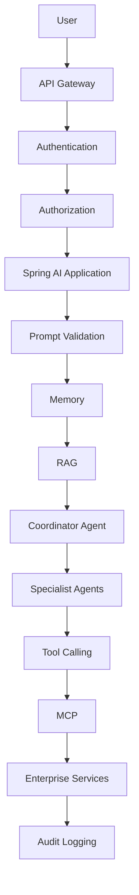
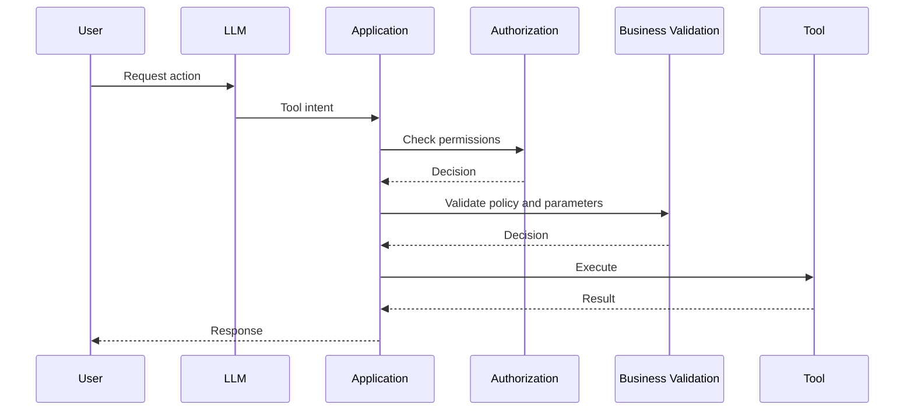

# Chapter 12: AI Security for Java Developers

This module is the Chapter 12 reference implementation for the Acme Corporation Enterprise Assistant.

It continues the architecture from Chapters 3 to 11 and applies defense in depth across prompts, RAG, tool calling, MCP, memory, and multi-agent orchestration.

## Project Overview

The assistant now supports enterprise security as a first-class architectural concern:

- JWT authentication with OAuth2 Resource Server
- Role and policy-based authorization inside the Spring Boot application
- Prompt injection detection and risk scoring
- Secure RAG with classification, ownership, metadata trust checks, and sanitization
- Tool invocation guards with authorization and business validation
- MCP capability boundaries with timeout and retry policy
- Conversation memory isolation with encrypted message persistence
- Governance and human-in-the-loop approvals
- Persistent audit and security event logging

## Security Model

Roles:

- EMPLOYEE
- HR
- FINANCE
- OPERATIONS
- ADMIN

Authorization decisions are always made by the application. The LLM does not make final security decisions.

## Architecture






## Authentication

- All business endpoints require JWT authentication.
- Anonymous access is limited to health endpoints.
- The service is configured as OAuth2 Resource Server.

## Authorization

- Endpoints are secured with role policies.
- Document and memory access enforce ownership and role checks.
- Tool and MCP invocations are blocked when role or capability constraints fail.

## Prompt Injection Protection

Core components:

- PromptSecurityService
- PromptValidator
- PromptRiskAnalyzer

The service detects patterns such as instruction override attempts, system prompt exfiltration, privilege escalation requests, and security bypass prompts.

## Secure RAG

RAG protections include:

- document classification
- document ownership checks
- trusted metadata validation
- content sanitization for indirect injection patterns

Only authorized documents are returned to each user context.

## Tool Calling Security

Every tool invocation path validates:

- authenticated principal
- role authorization
- input validation
- business rules and governance policies

## MCP Security

MCP calls are protected by:

- capability allow-lists per specialist agent
- timeout and retry policy
- audit records for each capability invocation

## Memory Security

- Conversation messages are persisted in encrypted form using a JPA converter.
- Memory is isolated by conversation ownership.
- Cross-user memory access is denied unless an administrator policy allows it.

## Multi-Agent Security

Coordinator routes requests to specialist agents:

- HR
- FINANCE
- OPERATIONS
- KNOWLEDGE

Each specialist has restricted MCP capabilities and tool surfaces.

## Governance and Human Approval Workflow

High-risk actions produce approval requests.

Examples:

- restart production server
- high-value expense approval

Approval endpoint:

- POST /approvals/{id}/approve

## Audit Logging and Security Events

Persisted records capture:

- authenticated user
- conversation id
- selected agent
- action and authorization result
- prompt risk score
- operation details and timestamp

## REST Endpoints

- POST /chat
- POST /chat/{conversationId}
- GET /audit
- GET /security/events
- GET /approvals
- POST /approvals/{id}/approve
- GET /documents
- POST /documents
- GET /memory/{conversationId}

## Running Locally (Ollama)

1. Start infrastructure:

```bash
docker compose up -d postgres ollama
```

2. Pull required local models:

```bash
docker exec -it chapter12-ollama ollama pull llama3.1
docker exec -it chapter12-ollama ollama pull nomic-embed-text
```

3. Run tests and application:

```bash
mvn clean test
mvn spring-boot:run
```

## Running with OpenAI

1. Export API key:

```bash
export OPENAI_API_KEY=<your-key>
```

2. Start with cloud profile:

```bash
mvn spring-boot:run -Dspring-boot.run.profiles=openai
```

## Docker Compose

The compose stack in this module includes:

- PostgreSQL with pgvector
- Ollama
- Optional Open WebUI (profile: ui)

Start with UI:

```bash
docker compose --profile ui up -d
```

## Testing

Run the full suite:

```bash
mvn clean test
```

Coverage includes:

- authentication and endpoint protection
- prompt injection detection
- governance and approval requirements
- tool authorization checks
- RAG document sanitization and metadata trust
- memory isolation policy
- Spring Boot context and Testcontainers smoke validation

## Project Structure

Primary package layout:

```text
src/main/java/com/acme/assistant/chapter12
├── config
├── security
├── controllers
├── services
├── agents
├── memory
├── rag
├── tools
├── mcp
├── authorization
├── validation
├── audit
├── monitoring
├── filters
├── governance
├── repositories
├── entities
├── dto
└── exceptions
```

