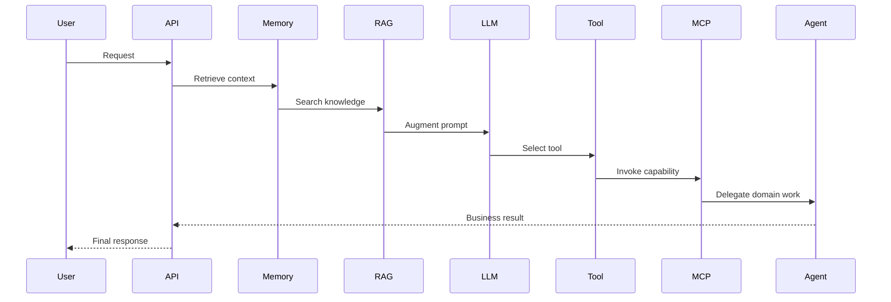

# Chapter 14: Observability and Monitoring for Enterprise AI Applications

This module continues the Acme Corporation Enterprise Assistant from Chapters 3 to 13 and turns the Chapter 13 assistant baseline into an observable, traceable, monitorable production-style AI platform.

The focus of Chapter 14 is not adding new business capabilities. It is making every AI workflow understandable in production through distributed traces, AI-specific metrics, structured logs, dashboards, alerting, and telemetry-driven improvement.

## Project Overview

This project demonstrates how a Spring Boot and Spring AI application can expose complete operational visibility across the actual Chapter 13 assistant capabilities:

- AI chat
- Prompt construction
- Conversation memory retrieval
- User-facing assistant continuation endpoints
- Document access and creation
- Approval workflows
- Audit and security event access
- Embedding and vector search
- Retrieval-Augmented Generation
- LLM invocation
- Tool Calling
- MCP communication
- Specialist agent execution
- Business workflow completion
- Token and cost monitoring

The implementation remains provider-independent and supports both local Ollama and a profile-driven OpenAI configuration.

## What This Module Includes

- Spring Boot Actuator with secured production endpoints
- Micrometer metrics for AI, RAG, tools, MCP, agents, workflows, and token usage
- Correlation-aware request telemetry with trace, span, request, conversation, workflow, and user identifiers
- Structured JSON logging using Logback and Logstash encoder
- OpenTelemetry-ready tracing integration with an OTLP collector
- Docker Compose monitoring stack with Prometheus, Grafana, Loki, Tempo, and the OpenTelemetry Collector
- Grafana dashboards and Prometheus alert rules for AI operations
- Integration tests covering health, metrics, Prometheus exposure, actuator security, and correlation headers
- Chapter 13-style assistant baseline services for prompt behavior, RAG retrieval, tool calling, MCP, memory, multi-agent coordination, and workflow execution that are now instrumented by the observability layer
- Restored assistant runtime endpoints carried forward from the corrected Chapter 13 baseline

## AI Observability Architecture

```mermaid
flowchart LR

User

API

Spring AI

Memory

RAG

LLM

Tool Calling

MCP

Agents

Enterprise Services

Response

OpenTelemetry

Prometheus

Grafana

Loki

Tempo

User --> API
API --> Spring AI
Spring AI --> Memory
Spring AI --> RAG
RAG --> LLM
LLM --> Tool Calling
Tool Calling --> MCP
MCP --> Agents
Agents --> Enterprise Services
Enterprise Services --> Response

API --> OpenTelemetry
Spring AI --> OpenTelemetry
Memory --> OpenTelemetry
RAG --> OpenTelemetry
LLM --> OpenTelemetry
Tool Calling --> OpenTelemetry
MCP --> OpenTelemetry
Agents --> OpenTelemetry
Enterprise Services --> OpenTelemetry

OpenTelemetry --> Prometheus
OpenTelemetry --> Loki
OpenTelemetry --> Tempo
Prometheus --> Grafana
Loki --> Grafana
Tempo --> Grafana
```

## Distributed AI Trace



## AI Monitoring Platform

```mermaid
flowchart TB

Metrics
Logs
Traces

OpenTelemetry Collector

Prometheus
Grafana
Loki
Tempo

Dashboards
Alerts

Metrics --> OpenTelemetry Collector
Logs --> OpenTelemetry Collector
Traces --> OpenTelemetry Collector

OpenTelemetry Collector --> Prometheus
OpenTelemetry Collector --> Loki
OpenTelemetry Collector --> Tempo

Prometheus --> Grafana
Loki --> Grafana
Tempo --> Grafana
Prometheus --> Alerts
Grafana --> Dashboards
```

## Supported AI Providers

- Local profile: Ollama with `llama3.1` and `nomic-embed-text`
- Cloud profile: OpenAI with `gpt-4.1-mini`

The local profile is the default. The OpenAI profile is activated with `openai` and reuses the same observability architecture.

## Technology Stack

- Java 25
- Spring Boot 4
- Spring AI 2.0.0 in this repository baseline
- Spring Boot Actuator
- Micrometer
- Micrometer Tracing
- OpenTelemetry OTLP exporter
- Prometheus
- Grafana
- Loki
- Tempo
- OpenTelemetry Collector
- Spring Security
- PostgreSQL
- PGVector
- Docker Compose
- Maven

## Local Monitoring Stack

The Docker Compose stack in this chapter starts:

- PostgreSQL with PGVector
- Ollama
- OpenTelemetry Collector
- Prometheus
- Loki
- Tempo
- Grafana

Start everything with one command:

```bash
docker compose up -d
```

Pull the default local model:

```bash
docker exec -it chapter14-ollama ollama pull llama3.1
```

## Running the Application

Run verification:

```bash
mvn verify
```

Run the application:

```bash
mvn spring-boot:run
```

Run with the OpenAI profile:

```bash
OPENAI_API_KEY=your-key mvn spring-boot:run -Dspring-boot.run.profiles=openai
```

## Secured Access

Default evaluator credentials:

- Username: `evaluator`
- Password: `evaluator-pass`

Public endpoint:

- `GET /actuator/health`
- `GET /api/ai-observability/health`

Secured endpoints require HTTP Basic authentication:

- `POST /chat`
- `POST /chat/{conversationId}`
- `GET /memory/{conversationId}`
- `GET /documents`
- `POST /documents`
- `GET /approvals`
- `POST /approvals/{id}/approve`
- `GET /audit`
- `GET /security/events`
- `GET /actuator/metrics`
- `GET /actuator/prometheus`
- `GET /actuator/env`
- `GET /actuator/configprops`
- `GET /metrics/ai`
- `GET /metrics/rag`
- `GET /metrics/tools`
- `GET /metrics/mcp`
- `GET /metrics/agents`
- `GET /metrics/workflows`
- `GET /metrics/tokens`
- `GET /metrics/business`
- `GET /api/ai-observability/**`

## REST API

### Carried-Forward Assistant Runtime Endpoints

```bash
curl -u EMP-1001:employee-pass -X POST http://localhost:8080/chat \
  -H "Content-Type: application/json" \
  -d '{
    "userId":"EMP-1001",
    "message":"Estimate my travel expense for Project Orion"
  }'
```

```bash
curl -u EMP-1001:employee-pass http://localhost:8080/memory/{conversationId}
```

```bash
curl -u EMP-1001:employee-pass http://localhost:8080/documents
```

```bash
curl -u hr-user:hr-pass http://localhost:8080/approvals
```

```bash
curl -u admin-user:admin-pass http://localhost:8080/audit
curl -u admin-user:admin-pass http://localhost:8080/security/events
```

### Core Observability Simulation Endpoints

```bash
curl http://localhost:8080/api/ai-observability/health
```

```bash
curl -u evaluator:evaluator-pass -X POST http://localhost:8080/api/ai-observability/traces/simulate \
  -H "Content-Type: application/json" \
  -d '{
    "conversationId":"conv-1401",
    "userId":"EMP-1001",
    "goal":"Estimate my travel expenses for Project Orion and notify leadership if policy constraints fail",
    "includeFailurePath":true
  }'
```

```bash
curl -u evaluator:evaluator-pass http://localhost:8080/api/ai-observability/metrics/report
```

```bash
curl -u evaluator:evaluator-pass -X POST http://localhost:8080/api/ai-observability/logs/simulate \
  -H "Content-Type: application/json" \
  -d '{
    "traceId":"trace-1401",
    "conversationId":"conv-1401",
    "promptVersion":"v4.3",
    "includeSensitiveMetadata":false
  }'
```

```bash
curl -u evaluator:evaluator-pass http://localhost:8080/api/ai-observability/dashboards/summary
```

```bash
curl -u evaluator:evaluator-pass http://localhost:8080/api/ai-observability/improvement/recommendations
```

```bash
curl -u evaluator:evaluator-pass http://localhost:8080/api/ai-observability/architecture/report
```

### AI Metrics API

```bash
curl -u evaluator:evaluator-pass http://localhost:8080/metrics/ai
curl -u evaluator:evaluator-pass http://localhost:8080/metrics/rag
curl -u evaluator:evaluator-pass http://localhost:8080/metrics/tools
curl -u evaluator:evaluator-pass http://localhost:8080/metrics/mcp
curl -u evaluator:evaluator-pass http://localhost:8080/metrics/agents
curl -u evaluator:evaluator-pass http://localhost:8080/metrics/workflows
curl -u evaluator:evaluator-pass http://localhost:8080/metrics/tokens
curl -u evaluator:evaluator-pass http://localhost:8080/metrics/business
```

### Prometheus Endpoint

```bash
curl -u evaluator:evaluator-pass http://localhost:8080/actuator/prometheus
```

## Correlation IDs and Structured Logging

Every request is enriched by the correlation filter with:

- Trace ID
- Span ID
- Request ID
- Conversation ID
- Workflow ID
- User ID

These identifiers are written to response headers and to structured JSON logs through MDC.

The application uses JSON logging via [src/main/resources/logback-spring.xml](src/main/resources/logback-spring.xml) and records:

- timestamp
- level
- thread
- logger
- MDC correlation fields
- message
- stack traces for errors

Sensitive content is intentionally not logged directly. The project demonstrates metadata-driven observability rather than dumping raw enterprise data into logs.

## Metrics Coverage

The application exposes AI-specific telemetry including:

- prompt execution time
- average response latency
- token usage
- RAG retrieval latency
- RAG similarity score
- retrieved document count
- tool invocation and failure counts
- MCP latency and failure rate
- agent selection frequency
- workflow duration
- business workflow counts
- approval latency and workflow success rate
- estimated daily cost and per-conversation cost

Prometheus scrapes the application from `/actuator/prometheus`, and the OpenTelemetry Collector exposes its own metric endpoint for Prometheus scraping.

## OpenTelemetry

The application includes OTLP exporter support and a fallback tracer so the module runs cleanly even when a full exporter-backed tracer is not auto-configured in local tests.

Collector configuration is in [otel-collector-config.yaml](otel-collector-config.yaml) and routes:

- traces to Tempo
- metrics to Prometheus
- logs to Loki

## Dashboards

Grafana is provisioned automatically with data sources for:

- Prometheus
- Loki
- Tempo

Dashboard JSON files are available in [dashboards](dashboards):

- `ai-overview-dashboard.json`
- `rag-dashboard.json`
- `tool-dashboard.json`
- `mcp-dashboard.json`
- `agent-dashboard.json`

Provisioning is configured in:

- [monitoring/grafana/provisioning/datasources/datasources.yml](monitoring/grafana/provisioning/datasources/datasources.yml)
- [monitoring/grafana/provisioning/dashboards/dashboards.yml](monitoring/grafana/provisioning/dashboards/dashboards.yml)

## Alerting

Prometheus alert rules are defined in [alerts/ai-alert-rules.yml](alerts/ai-alert-rules.yml).

Included examples cover:

- response latency above threshold
- tool failures above threshold
- MCP timeout or failure rate increase
- low grounding score
- daily token budget exceeded

Each alert includes a summary and a first troubleshooting direction.

## Monitoring URLs

After `docker compose up -d` and running the application locally:

- Application: `http://localhost:8080`
- Health: `http://localhost:8080/actuator/health`
- Prometheus: `http://localhost:9090`
- Grafana: `http://localhost:3000`
- Loki: `http://localhost:3100`
- Tempo: `http://localhost:3200`
- OTLP HTTP ingest: `http://localhost:4318`

Grafana login:

- Username: `admin`
- Password: `admin`

## Project Structure

```text
alerts/
dashboards/
monitoring/
src/
  main/
    java/com/example/chapter14/
      config/
      controller/
      dashboards/
      dto/
      logging/
      metrics/
      model/
      observability/
      security/
      service/
      telemetry/
      tracing/
  test/
otel-collector-config.yaml
prometheus.yml
docker-compose.yml
```

## Testing

The chapter includes controller and integration coverage for:

- carried-forward chat and memory endpoints
- public health endpoints
- secured actuator access
- secured AI metrics access
- secured business metrics access
- correlation headers
- observability report endpoints
- application context startup

Run all tests:

```bash
mvn verify
```

## Troubleshooting

- If Grafana shows no data, verify the application is running on port `8080` and Prometheus can scrape `/actuator/prometheus`.
- If traces are missing, confirm the collector is running and `OTEL_EXPORTER_OTLP_ENDPOINT` matches the collector endpoint.
- If OpenAI is used, set `OPENAI_API_KEY` before enabling the `openai` profile.
- If Docker on the host cannot resolve `host.docker.internal`, adjust the Prometheus scrape target in [prometheus.yml](prometheus.yml).

## References

- Chapter narrative: `../chapter-14.md`
- Application config: [src/main/resources/application.yml](src/main/resources/application.yml)
- OpenAI profile: [src/main/resources/application-openai.yml](src/main/resources/application-openai.yml)
- Structured logging: [src/main/resources/logback-spring.xml](src/main/resources/logback-spring.xml)
- Docker Compose stack: [docker-compose.yml](docker-compose.yml)
- OpenTelemetry Collector: [otel-collector-config.yaml](otel-collector-config.yaml)
- Prometheus config: [prometheus.yml](prometheus.yml)