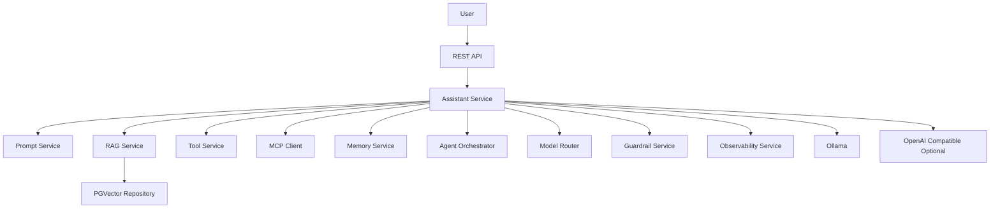

# Chapter 15 Enterprise AI Deployment Project

This project delivers the production-ready version of the Acme Corporation Enterprise Assistant for Chapter 15.

It combines chat, prompt engineering, RAG, vector search, tool calling, MCP integration, multi-agent workflows, memory, guardrails, security, observability, and deployment assets for Docker and Kubernetes.

## Chapter 15 Alignment

This implementation is the culmination of the previous chapters and focuses on deployment and operations:

- Stateless Spring Boot application for horizontal scaling.
- Model routing and graceful fallback.
- Operational metrics and health signals.
- Security guardrails and audit logging.
- Production packaging with Docker and Kubernetes manifests.

## Architecture



## APIs

- `POST /api/chat`
- `POST /api/rag/query`
- `POST /api/tools/execute`
- `POST /api/agents/run`
- `GET /api/health/ai`
- `GET /api/metrics/ai`

All `/api/*` endpoints require `Authorization: Bearer <token>`.

## Model Routing

Routing behavior in `ModelRouterService`:

- Simple HR requests -> local small model.
- Enterprise/general requests -> default model.
- Architecture requests -> reasoning model.
- Coding requests -> coding model.
- Cloud/fallback requests -> OpenAI profile model when profile is enabled.

All model names are configurable in `application.yml`.

## Docker

### Build

```bash
mvn clean package

docker build -t acme/chapter-15-enterprise-ai-deployment:1.0.0 .
```

### Run

```bash
docker run --rm -p 8080:8080 \
  -e SPRING_PROFILES_ACTIVE=docker \
  -e ASSISTANT_SECURITY_BEARER_TOKEN=dev-token \
  acme/chapter-15-enterprise-ai-deployment:1.0.0
```

## Docker Compose

Start full stack:

```bash
docker compose up --build
```

Services:

- `assistant-app`
- `ollama`
- `postgres-pgvector`
- `mock-mcp-server`

## Kubernetes

Manifests are in `k8s/`:

- `assistant-deployment.yaml`
- `assistant-service.yaml`
- `ollama-deployment.yaml`
- `ollama-service.yaml`
- `pgvector-statefulset.yaml`
- `pgvector-service.yaml`
- `configmap.yaml`
- `secret-example.yaml`
- `hpa.yaml`

Apply:

```bash
kubectl apply -f k8s/secret-example.yaml
kubectl apply -f k8s/configmap.yaml
kubectl apply -f k8s/pgvector-service.yaml
kubectl apply -f k8s/pgvector-statefulset.yaml
kubectl apply -f k8s/ollama-service.yaml
kubectl apply -f k8s/ollama-deployment.yaml
kubectl apply -f k8s/assistant-service.yaml
kubectl apply -f k8s/assistant-deployment.yaml
kubectl apply -f k8s/hpa.yaml
```

## Observability

Actuator and Micrometer are enabled.

AI metrics emitted:

- `ai.requests.total`
- `ai.model.selected`
- `ai.model.latency`
- `ai.tool.calls.total`
- `ai.rag.documents`
- `ai.tokens.estimated`
- `ai.agent.executions`
- `ai.mcp.calls`
- `ai.fallbacks`

Health endpoint:

- `GET /api/health/ai`

Metrics endpoint:

- `GET /api/metrics/ai`
- `GET /actuator/prometheus`

## Environment Variables

- `ASSISTANT_SECURITY_BEARER_TOKEN`
- `ASSISTANT_MCP_BASE_URL`
- `OPENAI_API_KEY`
- `OPENAI_BASE_URL`
- `SPRING_DATASOURCE_URL`
- `SPRING_DATASOURCE_USERNAME`
- `SPRING_DATASOURCE_PASSWORD`
- `SPRING_AI_OLLAMA_BASE_URL`

## Testing

```bash
mvn test
```

Test coverage includes:

- Chat orchestration and fallback.
- RAG retrieval behavior.
- Tool execution.
- MCP integration with WireMock.
- Model routing.
- Agent delegation.
- Prompt injection and PII redaction.
- HTTP integration tests for all `/api` endpoints with missing, invalid, and valid bearer-token scenarios.
- Docker profile configuration.
- PGVector Testcontainers smoke test.

## Production Considerations

- Keep app stateless and externalize memory/vector state.
- Use managed PostgreSQL for HA and backup policy in production.
- Enable OpenAI profile only where policy allows cloud inference.
- Use HPA and resource limits to keep latency/cost balanced.
- Keep MCP and tool allow lists minimal and audited.
