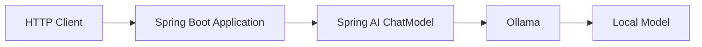

# Chapter 3 - Ollama Local (Spring AI Fundamentals)

This project is the local provider implementation for Chapter 3: Getting Started with Spring AI.

It demonstrates how Java developers can build an AI-powered Spring Boot application using:
- Spring AI fundamentals
- `ChatModel`, `Prompt`, and `ChatResponse`
- Dependency injection and auto-configuration
- A thin REST controller with service-layer AI interaction
- Basic validation, exception handling, and Actuator health checks

## Why This Project Exists

`chapter-03-ollama-local` is the local-first version of the same Acme Corporation assistant also implemented in `chapter-03-openai-cloud`.

The service code is provider-independent and depends only on `ChatModel`. Provider differences are handled by dependencies and configuration.

## Provider

- Provider: Ollama (local)
- API key required: No
- Default model: `llama3.2` (configurable)
- Other local model options: `llama3`, `qwen`, `mistral`, `deepseek-r1`

## Prerequisites

- Java 25
- Maven 3.9+
- Ollama installed locally

Ollama installation guide: https://ollama.com/download

## Run Ollama

Pull a model:

```bash
ollama pull llama3.2
```

Start Ollama:

```bash
ollama serve
```

## Run The Application

```bash
mvn clean test
mvn spring-boot:run
```

## Configuration

`src/main/resources/application.yml`:

```yaml
spring:
  ai:
    ollama:
      base-url: ${OLLAMA_BASE_URL:http://localhost:11434}
      chat:
        options:
          model: ${OLLAMA_CHAT_MODEL:llama3.2}
          temperature: ${OLLAMA_TEMPERATURE:0.2}
```

## API

Endpoint:

```http
POST /api/chat
Content-Type: application/json
```

Request:

```json
{
  "message": "Explain dependency injection in Spring Boot."
}
```

Response (example):

```json
{
  "response": "Dependency injection is a pattern where the Spring container provides object dependencies instead of classes creating them directly."
}
```

## Architecture



## Chapter 3 Alignment

This project intentionally excludes Chapter 4+ topics such as prompt templates, structured outputs, embeddings, RAG, agents, tool calling, MCP, memory, and multi-agent workflows.

## Why Local Ollama For Learning

- No API key required
- No per-token cloud cost during practice
- Great for local development and workshops
- Easy to compare with the cloud version that keeps the same service code
