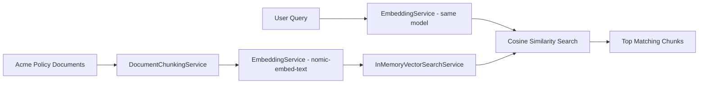

# Chapter 5: Acme Embeddings and Semantic Search

This Spring Boot project implements the Chapter 5 goal from the book: demonstrate how enterprise policy documents are chunked, embedded, and searched by meaning using Spring AI and Ollama.

The scope is intentionally focused on embeddings and semantic search only:

- No paid AI APIs
- No ChatModel workflow for generated answers
- No vector database yet (in-memory index only for learning clarity)

## Purpose

Acme Corporation has internal policy content such as:

- Remote work policy
- Annual leave policy
- Expense claim policy
- Password policy

When a user asks "Can I work from home?", semantic search should retrieve the remote work policy chunk even though the wording differs from "Employees may work remotely up to three days per week."

## Chapter 5 Mapping

This project demonstrates the chapter teaching points directly:

- Traditional keyword search matches words
- Semantic search matches meaning
- Embeddings are vectors of meaning
- EmbeddingModel generates vectors (not text)
- Documents are chunked before embedding
- Document and query embeddings use the same model
- Embeddings are generated during ingestion and reused during search
- Metadata stays attached to each chunk

## Architecture



## Tech Stack

- Java 25
- Spring Boot 4
- Spring AI
- Maven
- Ollama local runtime
- Embedding model: nomic-embed-text

## Package Structure

```text
src/main/java/com/acme/assistant
├── config
├── controller
├── service
├── embedding
├── document
├── search
├── model
└── exception
```

## Run Locally

1. Start Ollama:

```bash
docker compose up -d ollama
```

2. Pull the embedding model:

```bash
ollama pull nomic-embed-text
```

If Ollama runs in Docker only, pull from inside the container:

```bash
docker exec -it chapter5-ollama ollama pull nomic-embed-text
```

3. Run tests and start the app:

```bash
mvn clean test
mvn spring-boot:run
```

## Configuration

```yaml
spring:
  ai:
    ollama:
      base-url: ${OLLAMA_BASE_URL:http://localhost:11434}
      embedding:
        options:
          model: ${OLLAMA_EMBEDDING_MODEL:nomic-embed-text}
```

## API Examples

### 1) Ingest Acme sample policy documents

```bash
curl -X POST http://localhost:8080/api/documents/ingest \
  -H "Content-Type: application/json" \
  -d '{
        "documentIds": ["remote-work", "annual-leave", "expense-claims", "password-policy"],
        "chunkSize": 450,
        "overlap": 60
      }'
```

You can also send an empty body to ingest all default sample policies.

### 2) Perform semantic search

```bash
curl -X POST http://localhost:8080/api/search/semantic \
  -H "Content-Type: application/json" \
  -d '{
        "query": "Can I work from home?",
        "topK": 3
      }'
```

## Semantic vs Keyword Search

- Keyword search may fail when terminology differs.
- Semantic search compares vector similarity, so related wording can still match.
- Example: "work from home" can retrieve chunks about "work remotely".

## Notes For Next Chapters

- Chapter 6 will replace `InMemoryVectorSearchService` with PGVector.
- Chapter 7 will use the retrieval pipeline as the foundation for full RAG.

## Tests

The test suite is designed to run without Ollama for most checks:

- Cosine similarity unit test
- Document chunking unit test
- Semantic search ranking test with deterministic vectors

This keeps chapter tests fast and stable while still teaching production-relevant architecture.
