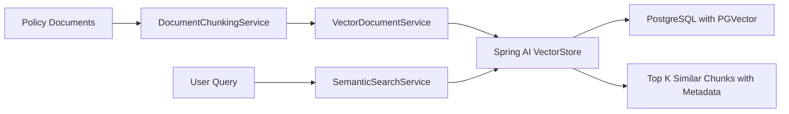

# Chapter 6: Vector Databases and Similarity Search

This project implements Chapter 6 for the Acme Corporation Enterprise Assistant.

It replaces Chapter 5's in-memory vector search with PostgreSQL + PGVector through Spring AI's `VectorStore` abstraction.

Scope for this chapter:

- Store document chunks in PGVector
- Preserve metadata with each chunk
- Run similarity search using semantic embeddings
- Return relevant chunks (not generated final answers)

It intentionally does not build full RAG yet. Chapter 7 adds retrieval + generation with `ChatModel`.

## Chapter 6 Mapping

- Chapter 5: chunking + embedding + in-memory search
- Chapter 6: chunking + embedding + PGVector search through `VectorStore`
- Chapter 7: RAG pipeline and response generation

## Architecture



## Why VectorStore and PGVector

- `VectorStore` keeps application code provider-agnostic.
- PGVector is a practical enterprise starting point when PostgreSQL is already in use.
- The vector database retrieves relevant knowledge; it does not generate answers.

## Tech Stack

- Java 25
- Spring Boot 4
- Spring AI 2
- Maven
- PostgreSQL + PGVector
- Ollama local embeddings (`nomic-embed-text`)
- Docker Compose

## Package Structure

```text
src/main/java/com/acme/assistant
├── config
├── controller
├── service
├── document
├── embedding
├── vector
├── search
├── model
└── exception
```

## Setup

### 1. Start PostgreSQL + PGVector

```bash
docker compose up -d
```

### 2. Start Ollama locally and pull embedding model

```bash
ollama pull nomic-embed-text
```

### 3. Build and run application

```bash
mvn clean test
mvn spring-boot:run
```

## Configuration

```yaml
spring:
  datasource:
    url: ${POSTGRES_URL:jdbc:postgresql://localhost:5432/acme_ai}
    username: ${POSTGRES_USER:postgres}
    password: ${POSTGRES_PASSWORD:postgres}

  ai:
    ollama:
      base-url: ${OLLAMA_BASE_URL:http://localhost:11434}
      embedding:
        options:
          model: ${OLLAMA_EMBEDDING_MODEL:nomic-embed-text}

    vectorstore:
      pgvector:
        initialize-schema: true

app:
  semantic-search:
    top-k: ${SEMANTIC_SEARCH_TOP_K:5}
```

## API

### Ingest documents into PGVector

Endpoint: `POST /api/documents/ingest`

```bash
curl -X POST http://localhost:8080/api/documents/ingest \
  -H "Content-Type: application/json" \
  -d '{
        "documents": [
          {
            "documentId": "travel-policy",
            "title": "Travel Policy",
            "content": "International travel requires manager approval. Employees may work remotely while travelling abroad only if legal and security controls are satisfied.",
            "department": "Operations",
            "category": "Travel",
            "source": "acme://policies/operations/travel"
          }
        ],
        "chunkSize": 450,
        "overlap": 60
      }'
```

If `documents` is omitted, the app ingests default Acme sample policies.

### Semantic vector search

Endpoint: `POST /api/search/vector`

```bash
curl -X POST http://localhost:8080/api/search/vector \
  -H "Content-Type: application/json" \
  -d '{
        "query": "Can I work remotely while travelling abroad?",
        "topK": 5,
        "department": "Operations",
        "category": "Travel"
      }'
```

Returns top matching chunks and metadata such as title, department, category, source, and score when available.

## Optional Sample Data Seeder

- Profile: `seed`
- Usage:

```bash
mvn spring-boot:run -Dspring-boot.run.profiles=seed
```

On startup, this ingests default Acme policy documents.

## Troubleshooting

- PostgreSQL not reachable:
  Verify `POSTGRES_URL`, `POSTGRES_USER`, `POSTGRES_PASSWORD`, and that `docker compose up -d` is running.
- PGVector schema issues:
  Keep `spring.ai.vectorstore.pgvector.initialize-schema=true`.
- Empty search results:
  Ingest documents first, then search. Also confirm query and filters are not over-constrained.
- Ollama errors:
  Ensure Ollama is running and `nomic-embed-text` is pulled.
- Similarity score missing:
  Some providers or versions may not return score in metadata for every query path.

## Notes for Chapter 7

This chapter only retrieves relevant knowledge.

Chapter 7 adds:

- RAG orchestration
- Prompt assembly with retrieved context
- `ChatModel`-based answer generation