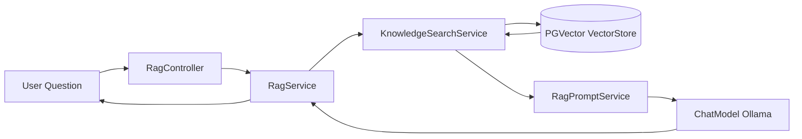
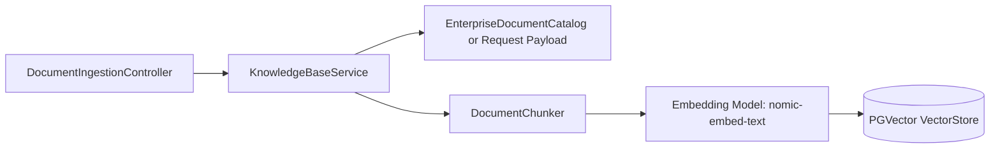
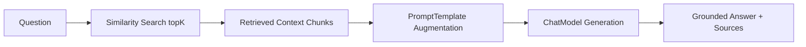

# Chapter 7: Building Retrieval-Augmented Generation (RAG) Applications

This project implements the Acme Corporation Enterprise Knowledge Assistant for Chapter 7 of *Generative and Agentic AI for Java Developers*.

The core teaching point is that RAG is an application architecture, not a model feature. The Spring Boot application orchestrates retrieval, prompt augmentation, and generation in separate steps.

## Purpose

- Build a complete enterprise RAG flow with Java 25, Spring Boot 4, Spring AI, Ollama, and PGVector.
- Keep ingestion and retrieval as distinct pipelines.
- Ground answers with source metadata.
- Prevent unsupported answers by instructing the model to answer only from retrieved context.

## Chapter 7 Mapping

- Chapter 5 introduced embeddings.
- Chapter 6 introduced vector databases.
- Chapter 7 combines those building blocks with prompt augmentation and generation for grounded enterprise Q&A.
- Chapter 8 will introduce AI agents; this chapter intentionally avoids agent/tool-calling patterns.

## RAG Architecture



## Ingestion Pipeline



## Retrieval + Generation Pipeline



## Important Concepts

- Ingestion and retrieval are separate pipelines.
- Vector databases retrieve relevant knowledge; they do not generate final answers.
- ChatModel generates the final response only after retrieval and prompt augmentation.
- Retrieval always happens before generation in this implementation.

## Tech Stack

- Java 25
- Spring Boot 4
- Spring AI
- Maven
- Ollama (local models only)
- PostgreSQL + PGVector

## Project Structure

```text
src/main/java/com/acme/assistant
├── config
├── controller
├── service
├── document
├── ingestion
├── rag
├── prompt
├── search
├── model
└── exception
```

## Ollama Setup

Start Ollama locally, then pull required models:

```bash
ollama pull nomic-embed-text
ollama pull llama3.2
```

Alternative chat models supported by configuration:

- llama3.2
- llama3
- qwen
- mistral
- deepseek-r1

## PostgreSQL + PGVector Setup

Use Docker Compose:

```bash
docker compose up -d pgvector ollama
```

The Compose file includes:

- PostgreSQL with PGVector image
- Persistent volume for PostgreSQL data
- Persistent volume for Ollama models

## Run the Application

```bash
mvn clean test
mvn spring-boot:run
```

Or run all services together:

```bash
docker compose up --build
```

## Configuration

Key settings in `src/main/resources/application.yml`:

- `spring.ai.ollama.chat.options.model`
- `spring.ai.ollama.chat.options.temperature`
- `spring.ai.ollama.embedding.options.model`
- `spring.ai.vectorstore.pgvector.initialize-schema`
- `app.rag.top-k`

## Example: Document Ingestion Request

```bash
curl -X POST http://localhost:8080/api/documents/ingest \
  -H "Content-Type: application/json" \
  -d '{
    "chunkSize": 220,
    "documents": [
      {
        "title": "Remote Work Policy",
        "source": "remote-work-policy",
        "content": "Employees may work remotely up to three days per week with manager approval. Remote work while travelling overseas requires manager and security approval.",
        "metadata": {"department": "HR"}
      },
      {
        "title": "Expense Claim Policy",
        "source": "expense-claim-policy",
        "content": "International expense claims must include original currency receipts and be submitted via the finance portal within 10 business days.",
        "metadata": {"department": "Finance"}
      }
    ]
  }'
```

## Example: RAG Question Request

```bash
curl -X POST http://localhost:8080/api/rag/ask \
  -H "Content-Type: application/json" \
  -d '{"question":"How do I submit an international expense claim?"}'
```

## Example Grounded Response

```json
{
  "question": "How do I submit an international expense claim?",
  "answer": "Submit the claim through the finance portal within 10 business days and include receipts in original currency plus USD conversion.",
  "sources": [
    {
      "source": "expense-claim-policy",
      "title": "Expense Claim Policy",
      "chunkIndex": 1,
      "snippet": "International expense claims must include original currency receipts and be submitted via the finance portal within 10 business days."
    }
  ]
}
```

## Testing

The test suite includes:

- Prompt construction unit test.
- Source mapping unit test.
- RagService behavior when no documents are found.
- RagService orchestration with mocked search/prompt/chat dependencies.
- Document chunking unit test.
- PGVector integration compatibility test via Testcontainers.

Unit tests do not require a live Ollama runtime.

## Chapter Progression Note

This chapter focuses on RAG architecture. Agent workflows, tool calling, MCP integration, and multi-agent memory are intentionally deferred to later chapters.
