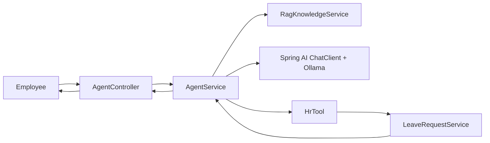

# Chapter 8 Agentic AI and Enterprise AI Agents

This project continues from Chapter 7 and implements the Chapter 8 architecture for an enterprise agent in the Acme Corporation Enterprise Assistant.

The scenario is intentionally business-focused:

> Employee request: "Book annual leave for next Friday."

The assistant does not just answer policy questions. It can also execute a controlled leave workflow through Spring services.

## How This Builds on Chapter 7

- Keeps Spring Boot 4 and Java 25 conventions.
- Keeps Spring AI with local Ollama as the default model provider.
- Extends the Chapter 7 "retrieve context then reason" pattern into "reason then execute tools".
- Separates retrieval context (`rag`) from operational execution (`tools` + `service`).

## What This Project Demonstrates

- AI agents are software systems, not only model calls.
- RAG-style policy context retrieval through a placeholder `RagKnowledgeService`.
- Domain-specific tools (`HrTool`) with narrow interfaces.
- Business execution stays in Spring services (`LeaveRequestService`), not in prompts.
- LLM performs intent reasoning while the application validates and executes state changes.

## Architecture



## Project Structure

```text
src/
├── main/
│   ├── java/com/acme/assistant/
│   │   ├── Chapter08AgentWorkflowsApplication.java
│   │   ├── config/
│   │   ├── controller/
│   │   ├── service/
│   │   ├── agent/
│   │   ├── tools/
│   │   ├── rag/
│   │   ├── model/
│   │   └── exception/
│   └── resources/application.yml
└── test/
```

## Prerequisites

- Java 25
- Maven 3.9+
- Ollama installed locally

## Quick Start (Local Ollama)

1. Pull a local chat model:

```bash
ollama pull llama3.2
```

2. Build and test:

```bash
mvn clean test
```

3. Run the app:

```bash
mvn spring-boot:run
```

Application URL: `http://localhost:8080`

## API

### Submit Agent Request

`POST /api/assistant/agent`

Example request:

```json
{
  "employeeId": "EMP-1001",
  "message": "Book annual leave for next Friday."
}
```

Example response:

```json
{
  "status": "ACTION_COMPLETED",
  "summary": "Leave request has been submitted for 2026-07-10.",
  "policyContext": "Acme Leave Policy: Employees can request annual leave...",
  "leaveBalance": {
    "employeeId": "EMP-1001",
    "availableDays": 12
  },
  "leaveRequestResult": {
    "requestId": "LR-7F2A8B4C",
    "status": "SUBMITTED",
    "message": "Leave request submitted for 2026-07-10 to 2026-07-10"
  }
}
```

## Mapping to Chapter 8

- Single-agent architecture with controlled orchestration.
- Distinguishes question answering from business action execution.
- Uses AI reasoning for decision support, then executes through domain services.
- Keeps tools narrow and domain-specific.

## Testing

Current tests include:

- `LeaveRequestServiceTest` for business rules and validation.
- `Chapter08AgentWorkflowsApplicationTest` for context startup.

## Next Steps for Chapter 9 and Chapter 10

- Chapter 9 (Tool Calling): Replace manual decision parsing with explicit Spring AI tool-calling callbacks and stronger tool schemas.
- Chapter 10 (MCP): Move `HrTool` to a remote MCP capability and keep the coordinator agent unchanged at the API layer.

## References

- Chapter write-up: `../chapter-8.md`
