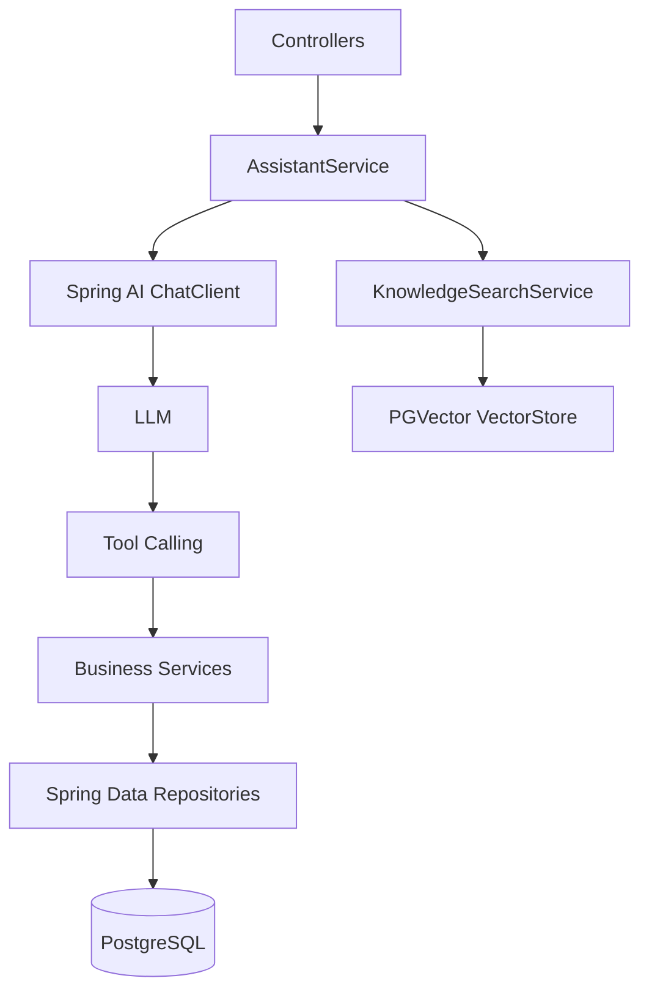
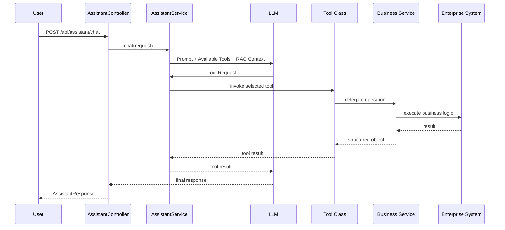
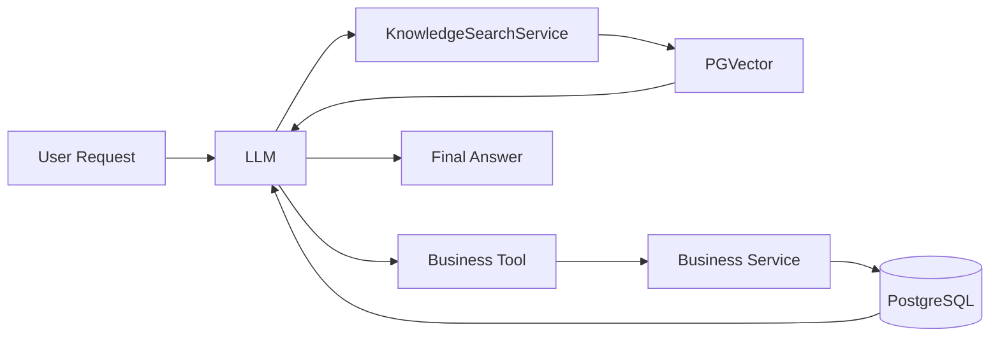
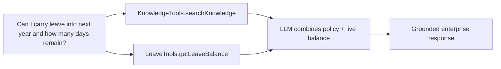

# Chapter 9: Tool Calling with Spring AI

Production-quality reference implementation for **Tool Calling** in Spring AI, built for Chapter 9 of *Generative and Agentic AI for Java Developers*.

This project extends the Chapter 7 RAG assistant with enterprise Tool Calling so the assistant can:

- answer documentation questions using RAG
- retrieve live enterprise information
- perform business operations
- select tools automatically
- combine multiple tools in one conversation

MCP is intentionally out of scope for this chapter.

## Technology Stack

- Java 25
- Spring Boot 4
- Spring AI
- Maven
- Ollama
- PostgreSQL + PGVector
- Spring Data JPA
- Docker Compose
- Lombok
- Jakarta Validation
- Spring Boot Actuator

## Models

Chat models (local via Ollama):

- llama3.2
- qwen3
- mistral
- deepseek-r1

Embedding model:

- nomic-embed-text

## Architecture



## Tool Calling Lifecycle



## RAG + Tool Calling



## Multi-Tool Workflow Example



## Enterprise Package Structure

```text
src/main/java/com/acme/assistant
├── config
├── controller
├── service
├── tool
├── rag
├── prompt
├── search
├── document
├── repository
├── entity
├── model
└── exception
```

## Prompt Engineering vs RAG vs Tool Calling

- Prompt Engineering: improves response quality using prompt design but cannot fetch live enterprise state.
- RAG: retrieves enterprise knowledge from documents (policy, process, guides).
- Tool Calling: executes business capabilities (lookup, schedule, submit, create).

In production systems, the assistant combines all three.

## Tools in This Chapter

- LeaveTools: getLeaveBalance, submitLeaveRequest
- MeetingTools: scheduleMeeting
- EmployeeTools: findEmployee
- ExpenseTools: submitExpense
- CustomerTools: findCustomer
- SupportTicketTools: createSupportTicket
- KnowledgeTools: searchKnowledge

All tools are thin adapters. Business logic remains in services.

## Setup

1. Start infrastructure:

```bash
docker compose up -d postgres ollama
```

2. Pull models:

```bash
docker exec -it chapter9-ollama ollama pull llama3.2
docker exec -it chapter9-ollama ollama pull qwen3
docker exec -it chapter9-ollama ollama pull mistral
docker exec -it chapter9-ollama ollama pull deepseek-r1
docker exec -it chapter9-ollama ollama pull nomic-embed-text
```

3. Run tests:

```bash
mvn test
```

4. Run application:

```bash
mvn spring-boot:run
```

## API Endpoints

- POST /api/assistant/chat
- POST /api/documents/ingest
- GET /actuator/health

## Example Conversations

### 1) Leave Balance

User:

```text
How many leave days do I have remaining?
```

Expected behavior:

- Assistant selects LeaveTools.getLeaveBalance
- Returns structured leave data through the tool layer
- Responds in natural language

### 2) Leave Booking

User:

```text
Book annual leave for next Friday.
```

Expected behavior:

- Assistant collects dates if missing
- Calls LeaveTools.submitLeaveRequest
- Enforces leave balance validation in LeaveRequestService

### 3) Meeting Scheduling

User:

```text
Schedule a meeting with Sarah.
```

Expected behavior:

- Assistant invokes MeetingTools.scheduleMeeting
- Persists meeting details and returns meeting identifier

### 4) Support Ticket Creation

User:

```text
Create a support ticket.
```

Expected behavior:

- Assistant gathers summary/priority details
- Uses SupportTicketTools.createSupportTicket
- Validates customer identity via CustomerService

### 5) Customer Lookup

User:

```text
Look up customer ACME-1024.
```

Expected behavior:

- Assistant invokes CustomerTools.findCustomer
- Returns customer profile data from enterprise repository

### 6) Expense Submission

User:

```text
Submit my hotel expense.
```

Expected behavior:

- Assistant invokes ExpenseTools.submitExpense
- Persists claim with generated enterprise expense id

### 7) Combined RAG + Tool Calling

User:

```text
Can I carry leave into next year and how many days remain?
```

Expected behavior:

- Assistant uses RAG search to retrieve policy content
- Assistant uses LeaveTools.getLeaveBalance for live data
- Final response combines policy grounding and transaction data

### Example: Ingest documents

```bash
curl -X POST http://localhost:8080/api/documents/ingest \
  -H "Content-Type: application/json" \
  -d '{
    "chunkSize": 250,
    "documents": [
      {
        "title": "Leave Policy",
        "source": "hr-policy.md",
        "content": "Employees can carry up to 5 annual leave days into the next year.",
        "metadata": {"department": "HR"}
      }
    ]
  }'
```

### Example: Tool Calling chat

```bash
curl -X POST http://localhost:8080/api/assistant/chat \
  -H "Content-Type: application/json" \
  -d '{
    "message": "Can I carry leave into next year and how many days remain?",
    "employeeId": "EMP-1001"
  }'
```

### Example Response (illustrative)

```json
{
  "question": "Can I carry leave into next year and how many days remain?",
  "answer": "Policy allows carry-over up to 5 days. You currently have 14 annual leave days remaining.",
  "sources": [
    {
      "title": "Leave Policy",
      "source": "hr-policy.md",
      "content": "Employees can carry up to 5 annual leave days...",
      "metadata": {
        "department": "HR"
      }
    }
  ],
  "timestamp": "2026-07-04T09:00:00Z"
}
```

## Testing Strategy

- Unit tests for service and search behavior
- Web layer tests for controllers
- Mocked ChatModel context test (no Ollama required)
- Mocked VectorStore unit test
- Testcontainers PostgreSQL integration test for JPA repository

## Observability and Actuator

The project includes Spring Boot Actuator for production diagnostics:

- `GET /actuator/health`
- `GET /actuator/info`
- `GET /actuator/metrics`
- `GET /actuator/prometheus`

Useful runtime checks:

```bash
curl http://localhost:8080/actuator/health
curl http://localhost:8080/actuator/metrics/http.server.requests
curl http://localhost:8080/actuator/metrics/jvm.memory.used
```

Recommended chapter extension for production teams:

- Add custom metrics for tool invocation count by tool name
- Add timer metrics for each tool execution duration
- Add failure counters for validation and downstream errors

## Docker

`docker-compose.yml` includes:

- PostgreSQL with PGVector image
- Persistent PostgreSQL volume
- Ollama runtime
- Assistant application container

## Future Extension (Chapter 10)

Chapter 10 introduces MCP to discover and invoke tools across application boundaries. This Chapter 9 project intentionally keeps tools local to one Spring Boot application.
